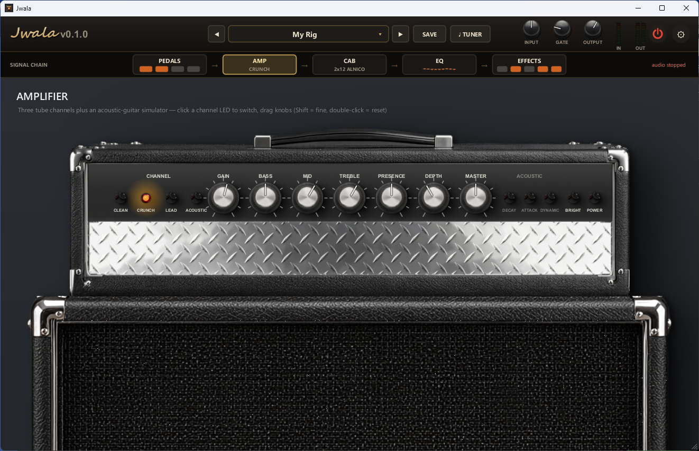
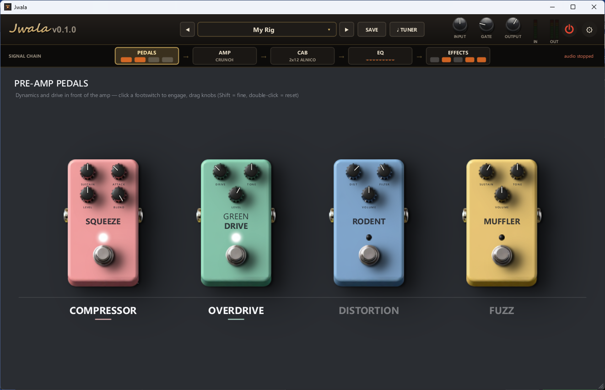
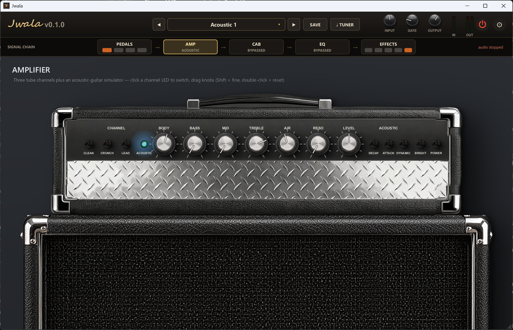
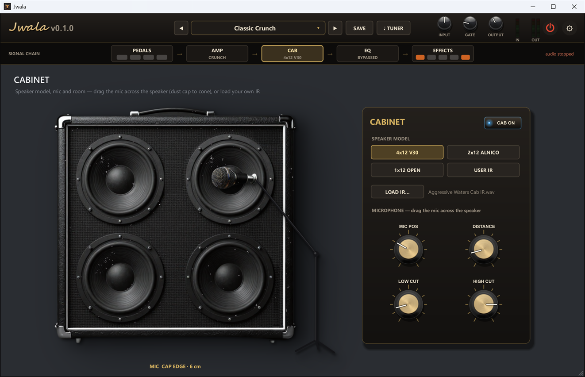
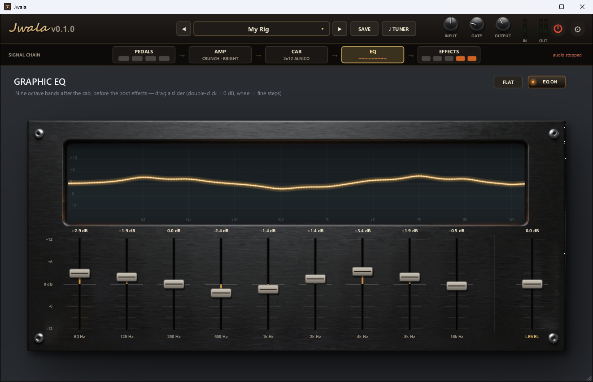
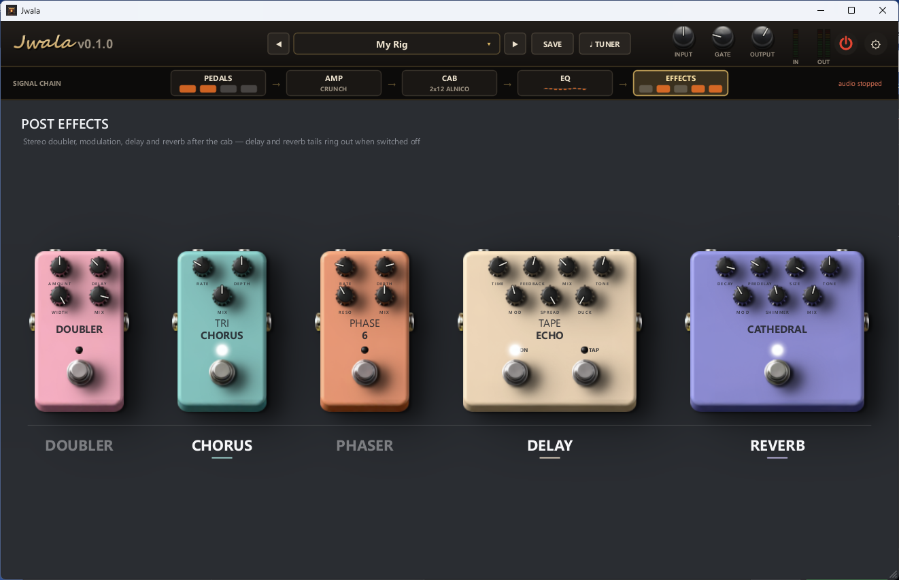
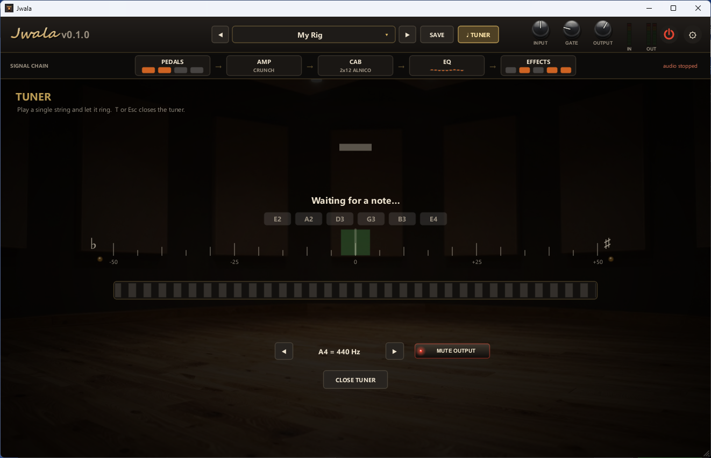

# Jwala: Guitar Amp & Effects Rig

Jwala is a guitar amp simulator with a full signal chain: pedals, a tube amp, a speaker cabinet, a graphic EQ and stereo effects. It runs as a **standalone app** (ASIO / WASAPI) or as a **VST3 / CLAP plugin** in your DAW. It's written in Rust and draws its UI on the GPU.

> **Fully vibecoded:** every line of Jwala, from the DSP to the GPU UI, was written with Claude Opus 5.5.



## Features at a glance

- **Signal chain:** Pedals → Amp → Cab → EQ → Effects, one page per stage.
- **Amp:** three tube channels (Clean, Crunch, Lead), plus an **acoustic-guitar simulator** for electric DI.
- **4 drive and dynamics pedals:** compressor, overdrive, distortion and fuzz.
- **Cabinet:** 3 built-in speaker models or your own impulse response, with a mic you drag across the speaker.
- **9-band graphic EQ** with a live response curve.
- **5 stereo effects:** doubler, chorus, phaser, tape echo and a shimmer reverb. Delay and reverb tails keep ringing when switched off.
- **Chromatic tuner** with strobe and adjustable A4 reference.
- **12 factory presets**, user presets, and the last state restored on launch.
- **Plugin parameters are host-automatable**, and the DSP runs at **4x oversampling** for the drive stages.
- Builds for **Windows, macOS and Linux** (the macOS and Linux builds compile in CI but haven't been tested).

## The rig

### Header and global controls

Along the top: the preset selector (◀ ▶ to step, **SAVE** to store your own), **TUNER**, the **INPUT** (±12 dB), noise **GATE** and **OUTPUT** knobs, in/out meters, the power button and **⚙ Settings**. Below it, the **signal chain** bar shows every stage at a glance: which pedals are on, the amp channel, the cab model, a mini EQ curve and the active effects. Click a stage to open its page.

### Pre-amp pedals



| Pedal | Type | Controls |
|---|---|---|
| **SQUEEZE** | Compressor | Sustain, attack, level, parallel blend |
| **GREEN DRIVE** | Mid-hump overdrive | Drive, tone, level |
| **RODENT** | Op-amp distortion | Distortion, filter, volume |
| **MUFFLER** | Fuzz | Sustain, tone, volume |

Click a footswitch to engage a pedal.

### Amplifier

| Tube channels | Acoustic channel |
|---|---|
|  |  |

- **Clean / Crunch / Lead** channels with 2, 3 or 4 triode stages. Each stage has asymmetric grid-conduction clipping and dynamic bias shift, so the amp responds to how hard you pick.
- **GAIN, BASS, MID, TREBLE** (a Marshall-style tone stack), **PRESENCE, DEPTH, MASTER** (drives the push-pull power amp, with supply sag) and a **BRIGHT** switch.
- The **Lead** channel is voiced for a smooth, even high-gain sound: low notes stay tight and the treble comes from the harmonics rather than from fizz.
- The **Acoustic** channel turns an electric DI into an acoustic guitar. The knobs become **BODY, BASS, MID, TREBLE, AIR, RESO, LEVEL**, the cab's speaker is bypassed, and the guitar is heard through a spaced stereo pair of room mics. Three switches shape the strings:
  - **DECAY**: shortens the electric's long sustain, the way a real acoustic top absorbs string energy.
  - **ATTACK**: reshapes the first 20 ms of each pick (less pickup spike, more string zing).
  - **DYNAMIC**: harder picking sounds brighter.

### Cabinet



- Speaker models: **4x12 V30**, **2x12 Alnico**, **1x12 Open**, or **USER IR** (load any `.wav` impulse response).
- **Drag the mic** across the speaker, from the dust cap to the cone edge, or use **MIC POS**.
- **DISTANCE** (proximity effect and room), **LOW CUT** and **HIGH CUT**.
- Zero-latency SIMD convolution.

### Graphic EQ



9 octave bands from 63 Hz to 16 kHz (±12 dB each) plus **LEVEL**, in stereo after the cab. The response curve updates live; **FLAT** resets every band. The EQ is off by default.

### Post effects (stereo)



| Effect | What it does |
|---|---|
| **DOUBLER** | Fakes a double-tracked part: two takes with drifting timing, pitch, level and tone, spread hard left/right |
| **TRI CHORUS** | Lush stereo chorus |
| **PHASE 6** | 6-stage phaser with resonance |
| **TAPE ECHO** | Delay with glide, wow & flutter, darkening and saturating repeats, ping-pong spread, ducking and **tap tempo** |
| **CATHEDRAL** | Modulated 8-line feedback-delay-network reverb with pre-delay, size, damping and an octave-up **shimmer** |

### Tuner



Shows the note, a cents needle, a strobe and the nearest standard-tuning string. The A4 reference goes from 425 to 455 Hz, and the output can be muted while you tune.

## Presets

12 factory presets: **Init, Glass Clean, Ambient Shimmer, Classic Crunch, Blues Lead, Modern Metal, Soaring Solo, Fuzz Wall, Rodent Grunge, Acoustic 1, Acoustic 2, Acoustic 3**.

**SAVE** stores your own presets as JSON in `%AppData%\Jwala\presets\`. **Ctrl+←/→** steps through presets.

## Controls

| Action | How |
|---|---|
| Turn a knob | Drag up/down (hold **Shift** for fine control) or use the mouse wheel |
| Reset a knob | Double-click |
| See a knob's value | Hover over it |
| Switch pages | Click the signal chain, or press **1–5** |
| Power on/off | **Space**, the **⏻** button, or the amp's jewel lamp |
| Tuner | **T** (Esc closes it) |
| Resize the window | Drag the bottom-right grip |

## Getting started (standalone)

1. Run `Jwala.exe`. Audio starts automatically with your last device: ASIO if available, otherwise WASAPI. The status at the top right says why if it can't start.
2. Open **⚙ Settings** to choose the driver, the input/output device and the input channel. For ASIO, buffer size and sample rate come from the driver's control panel, which you can open from Settings.
3. No guitar handy? Choose **DI file** in Settings to loop a dry recording (`.wav`) through the rig.

Settings and the last state are saved in `%AppData%\Jwala\jwala-rs.json`.

## Plugin

Copy `Jwala.vst3` and/or `Jwala.clap` to your plugin folders, then rescan in your DAW:

| OS | VST3 | CLAP |
|---|---|---|
| Windows | `C:\Program Files\Common Files\VST3` | `C:\Program Files\Common Files\CLAP` |
| macOS | `~/Library/Audio/Plug-Ins/VST3` | `~/Library/Audio/Plug-Ins/CLAP` |
| Linux | `~/.vst3` | `~/.clap` |

Every control is an automatable parameter whose ID is its preset key (`amp.GAIN`, `comp.ON`, `cab.MIC POS`, …), so presets saved in the standalone load in the plugin too.

### macOS: removing the download quarantine

The macOS build is a universal binary (Apple Silicon and Intel) but isn't signed with an Apple Developer ID or notarized, so macOS quarantines it when it's downloaded through a browser. The standalone then shows "can't be opened" or "is damaged", and some DAWs (Logic in particular) won't load or list the plugins. Clear the quarantine once after installing:

```bash
xattr -dr com.apple.quarantine ~/Library/Audio/Plug-Ins/VST3/Jwala.vst3 ~/Library/Audio/Plug-Ins/CLAP/Jwala.clap
```

For the standalone, run `xattr -dr com.apple.quarantine` on the unzipped `Jwala` too, or right-click it and choose **Open** once.

## Building from source

Requires a recent stable [Rust](https://rustup.rs/) toolchain.

```bash
cd rust
cargo build --release
```

On Windows, `rust\build.ps1` builds and packages everything into `rust\dist\` (`Jwala.exe`, `Jwala.vst3`, `Jwala.clap`). On Linux, install the ALSA/JACK and X11/Vulkan development packages first (see [`.github/workflows/build.yml`](.github/workflows/build.yml) for the exact list). The **Build** GitHub Actions workflow produces Windows, macOS and Linux packages.

> **Note:** The Windows build should work but still may have bugs. The macOS and Linux builds compile, but have not been tested.

### Offline rendering

The standalone can render a file through a preset without opening the UI:

```bash
Jwala.exe --render in.wav out.wav "Classic Crunch" amp.GAIN=0.7 ir=my_cab.wav
```

`key=value` pairs override preset parameters, and `ir=` sets the USER IR (used with `cab.MODEL=3`). Other dev flags: `--no-audio` (start without opening a device) and `--audio-test list | asio "<driver>" [input] | wasapi`.

## Under the hood

- **Framework:** [nih-plug](https://github.com/robbert-vdh/nih-plug) for VST3/CLAP. The DSP in `rust/src/dsp/` is independent of the plugin layer.
- **UI:** a custom **wgpu** renderer. One instanced shader draws every primitive (rounded rects, mipmapped images, glyph-atlas text, glows, lines); pedal and knob soft shadows are real GPU blur passes, cached until the layout changes.
- **Amp DSP:** 4x oversampled pedals, preamp, tone stack and power amp; the tone stack uses the Yeh & Smith circuit discretization.
- **Reverb:** a Hadamard feedback delay network with modulated lines and a self-limiting octave-up shimmer loop.
- **Acoustic sim:** corrects the magnetic pickup's coil resonance, adds string sparkle with a level-independent 2nd-harmonic exciter, then convolves with a synthetic modal body IR plus air-cavity and top-plate resonators. Its tone was matched against a real acoustic recording.
- `old-csharp-legacy/` holds the original C# / .NET 8 / NAudio version of the app, The Rust port's offline renders match it to float rounding for every factory preset.

## License

Code: [GPL-3.0](LICENSE). Artwork in `assets/`: [CC BY-SA 4.0](https://creativecommons.org/licenses/by-sa/4.0/).
